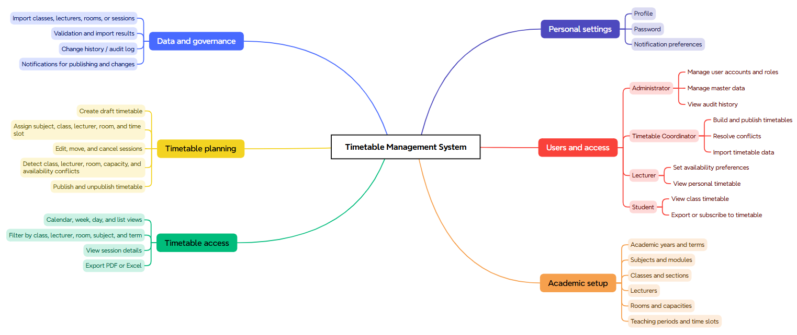
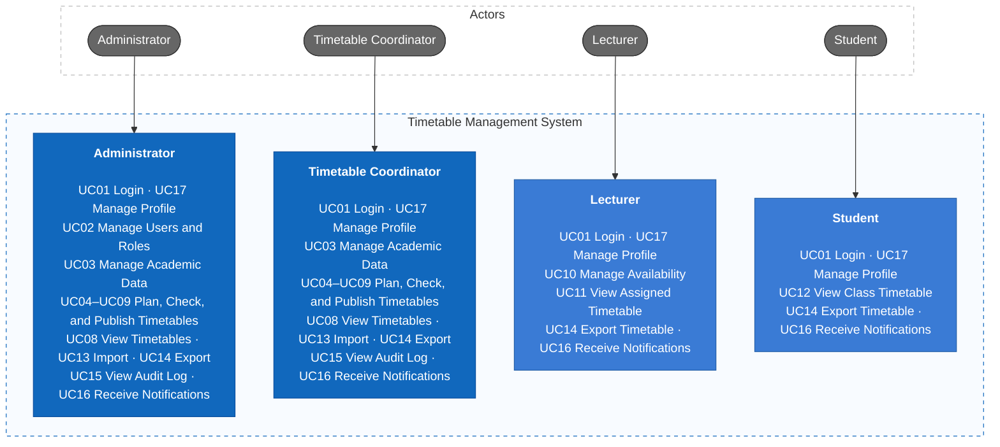
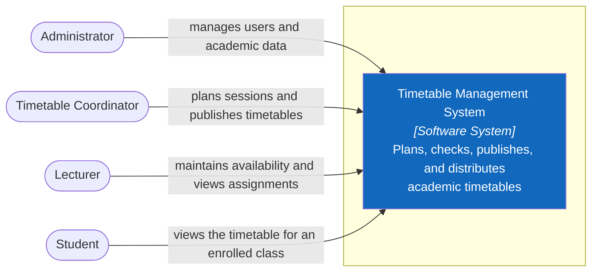
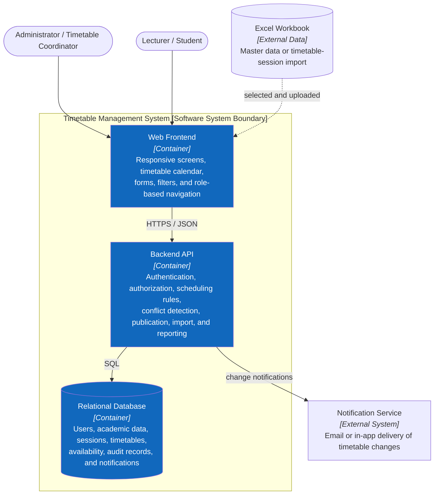
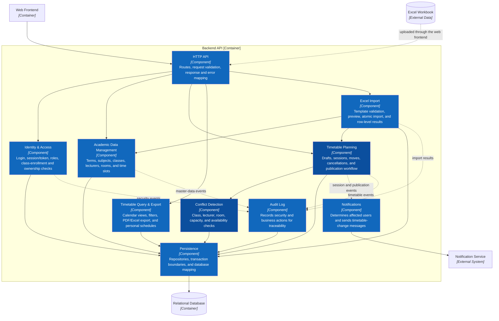

# Timetable Management System — Analysis

This analysis defines an academic timetable-management system for a school or university that publishes teaching timetables for classes, lecturers, and rooms.

## 1. Requirements — INVEST, Use Cases, and Acceptance Criteria

Requirements state the intended users, system value, and observable success conditions. Each user story is assessed using INVEST and is linked to a use case and acceptance criteria.

### 1.1 Product mind map



### 1.2 INVEST requirements

The V1 backlog has 17 user stories. It covers access, academic master data, timetable planning and publication, personal views, import/export, audit, user administration, and profiles.

| Criterion | Meaning in the Timetable Management System |
| --- | --- |
| **Independent** | Each story supplies one business capability; it relies on master data only where necessary. |
| **Negotiable** | UI layout, scheduling algorithm, and technical design may change while business rules and permissions remain intact. |
| **Valuable** | Every story helps users create a reliable timetable, avoid clashes, or obtain accurate schedule information. |
| **Estimable** | Actors, inputs, outputs, validations, authorization, dependencies, and failure outcomes are identified. |
| **Small** | Each story can be delivered as API, application rules, persistence, UI, and test tasks within one iteration. |
| **Testable** | Every story has observable acceptance criteria, including permission, validation, and conflict outcomes. |

| ID | User story | Acceptance criteria |
| --- | --- | --- |
| US01 | As a user, I want to sign in and sign out so that only authorized people can access timetable data. | Valid credentials create a session; invalid or inactive accounts are rejected; sign-out invalidates the client session. |
| US02 | As an administrator, I want to manage users and roles so that responsibilities are controlled. | Administrator can create, activate, deactivate, and assign roles; non-administrators cannot access this function. |
| US03 | As an administrator, I want to manage academic years, terms, subjects, classes, rooms, lecturers, and time slots. | Required fields are validated; duplicate identifiers are rejected; inactive master data cannot be selected for new sessions. |
| US04 | As a coordinator, I want to create a timetable draft for a selected term. | A draft is associated with one term; only one published timetable exists per term; the draft is not visible to students until published. |
| US05 | As a coordinator, I want to add a teaching session with class, subject, lecturer, room, date, and time slot. | All required assignments exist and are active; start time precedes end time; successful creation appears in the draft calendar. |
| US06 | As a coordinator, I want to edit, move, or cancel a draft session. | Changes are saved only after validation; cancellation records a reason; published sessions require a revision workflow or authorized override. |
| US07 | As a coordinator, I want the system to detect scheduling conflicts before saving. | The system blocks overlapping class, lecturer, or room assignments; it flags room-capacity and lecturer-availability violations; messages identify the conflicting sessions. |
| US08 | As a coordinator, I want to see timetable views and filters so that I can plan efficiently. | Day, week, and list views are available; filters work for term, class, lecturer, room, and subject; filtered results reflect the selected criteria. |
| US09 | As a coordinator, I want to publish or unpublish a conflict-free timetable. | Publishing is blocked while blocking conflicts exist; publication records actor and timestamp; authorized users may return it to draft with a reason. |
| US10 | As a lecturer, I want to submit my availability preferences. | Lecturer can create or update preferences for permitted periods; overlapping preferences are prevented; coordinators can view but not silently alter lecturer-entered preferences. |
| US11 | As a lecturer, I want to view my assigned timetable. | Only the logged-in lecturer’s sessions are shown by default; session details include class, room, subject, time, and status. |
| US12 | As a student, I want to view my class timetable. | Students can view only their enrolled class or section timetable; cancelled and changed sessions have clear status indicators. |
| US13 | As an authorized coordinator, I want to import master data or timetable sessions from Excel. | Only approved file types and templates are accepted; validation errors identify row and column; no rows are committed when an atomic import has errors. |
| US14 | As a user, I want to export my permitted timetable so that I can use it offline. | Export honors current filters and authorization; PDF and Excel output contain the same sessions shown in the view. |
| US15 | As an administrator or coordinator, I want to view an audit log so that important changes are traceable. | Creation, update, cancellation, import, publish, unpublish, login, and user changes record actor, time, action, and affected item. |
| US16 | As a user, I want to receive notifications when a published timetable or assigned session changes. | Notifications identify the changed session and new schedule; users receive only relevant notifications according to their role and subscriptions. |
| US17 | As a user, I want to manage my profile, password, and notification preferences. | Users can update their own permitted profile fields; password change requires current password; preference changes take effect for future notifications. |

```text
US01              Authentication and session
US02              User and role management
US03              Academic master data
US04–US09         Timetable planning, conflict checking, and publication
US10–US12         Lecturer availability and personal/class timetable views
US13–US14         Import and export
US15–US16         Audit and notifications
US17              Profile, password, and preferences
```

### 1.3 Use cases



The detailed use-case diagram, including individual use cases and their relationships, is in [docs/use-cases.md](docs/use-cases.md).

### 1.4 Roles and permissions

| Capability | Administrator | Timetable Coordinator | Lecturer | Student |
| --- | --- | --- | --- | --- |
| View published timetables | Yes | Yes | Own assignments | Own class/section |
| Manage users and roles | Yes | No | No | No |
| Manage academic master data | Yes | Yes | No | No |
| Create/edit timetable drafts and sessions | Yes | Yes | No | No |
| Resolve conflicts and publish | Yes | Yes | No | No |
| Set lecturer availability | No | View only | Own preferences | No |
| Import Excel data | Yes | Yes | No | No |
| Export timetable | Yes | Yes | Own timetable | Own timetable |
| View audit log | Yes | Yes | No | No |
| Receive change notifications | Yes | Yes | Yes | Yes |
| Manage own profile and password | Yes | Yes | Yes | Yes |

The backend must enforce role-based access control, class-enrollment restrictions, and lecturer ownership rules. Hiding controls in the user interface is not an authorization mechanism.

## 2. Information Architecture, Screen Hierarchy, and UI/UX

The information architecture groups the authenticated workspace by user goal. Navigation and screen access follow the permission matrix, while loading, empty, validation, conflict, error, saving, and success states are consistently defined.

### 2.1 Information architecture

```text
Public
└── Login

Authenticated
├── Dashboard
├── Timetables
│   ├── Calendar / Week / Day / List
│   ├── Session detail
│   └── Export
├── Planning (Administrator, Coordinator)
│   ├── Draft timetable
│   ├── Session editor
│   ├── Conflict panel
│   └── Publish history
├── Academic Data (Administrator, Coordinator)
│   ├── Academic years and terms
│   ├── Subjects
│   ├── Classes and sections
│   ├── Lecturers
│   ├── Rooms
│   └── Time slots
├── Availability (Lecturer; coordinator read-only)
├── Import (Administrator, Coordinator)
├── Audit Log (Administrator, Coordinator)
├── Users (Administrator)
├── Notifications
├── Profile and Preferences
└── Forbidden / Not Found
```

### 2.2 Screen hierarchy and primary flows

Login opens the authenticated application shell. The shell owns global navigation, term selection, notifications, and profile access. Timetable pages own calendar filters and session details; planning owns draft editing, conflict resolution, and publishing. Unauthorized routes resolve to **Forbidden**.

| Flow | Screens and expected outcome |
| --- | --- |
| Build and publish | Planning → select term/draft → add or edit session → conflict check → resolve blocking conflicts → publish confirmation → published timetable and notifications. |
| Lecturer availability | Availability → choose dates/time slots → save preferences → coordinator sees constraints during planning. |
| Find a timetable | Timetables → choose term and class/lecturer/room filter → view calendar or list → open session detail → optional export. |
| Import | Import → upload template → preview validation → correct errors or confirm → import result → audit entry. |
| Manage data | Academic Data → list → create/edit modal or detail screen → validation → saved confirmation. |

### 2.3 UI/UX rules and screen states

| State | Required behavior |
| --- | --- |
| Loading | Use a non-blocking skeleton for calendar/list content and preserve the active filter context. |
| Empty | Explain why no sessions are visible and provide the permitted next action, such as changing filters or creating a draft. |
| Validation | Show field-level messages next to invalid inputs and preserve user-entered values. |
| Conflict | Display a prominent, accessible conflict panel containing conflict type, affected resource, time, and links to the colliding sessions. Block publish for blocking conflicts. |
| Saving | Disable duplicate submission, show progress, and retain the draft until the result is known. |
| Success | Confirm the action, update the calendar/list immediately, and expose the changed session when useful. |
| Error | Use plain-language messages, retain unsaved form data where safe, and offer retry or recovery guidance. |
| Accessibility | Support keyboard calendar navigation, visible focus, semantic labels, sufficient contrast, and color-independent indicators for cancelled, changed, and conflicting sessions. |

### 2.4 Suggested dashboard

The dashboard should give each role a short path to their next task:

- **Administrator:** active term, publication status, unresolved conflicts, import failures, and recent audit events.
- **Coordinator:** draft versus published status, sessions awaiting assignment, conflicts, upcoming changes, and quick actions to plan or publish.
- **Lecturer:** today’s and next sessions, availability reminder, and recent schedule changes.
- **Student:** today’s and next classes, room changes, cancelled classes, and the current term timetable.

## 3. C4 Architecture

This section describes the target architecture at C4 Levels 1–3. The diagrams are technology-neutral so that the selected frontend and backend frameworks can change without changing the system responsibilities.

### C1 — System Context



### C2 — Container



### C3 — Component



The C3 design makes conflict detection a separate component so the same rules can be applied consistently when a session is created, edited, imported, or published.
